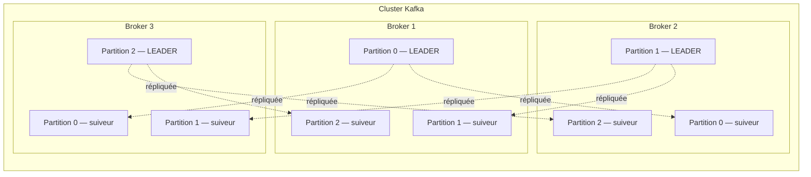

# Cluster Kafka : 3 brokers et 3 partitions

Chaque partition possède trois répliques (facteur de réplication **3**), réparties sur les trois brokers. Une seule réplique par partition est leader ; les deux autres sont des suiveurs.

La configuration Docker du projet définit `KAFKA_NUM_PARTITIONS: 3` et `KAFKA_DEFAULT_REPLICATION_FACTOR: 3` pour les topics créés avec les paramètres par défaut.

## Glossaire Kafka

- **Broker** : serveur Kafka qui stocke des partitions et traite les requêtes des producteurs et des consommateurs. Les trois brokers de ce cluster sont `kafka-1`, `kafka-2` et `kafka-3`.
- **Topic** : flux logique nommé dans lequel les producteurs publient des messages et que les consommateurs lisent. Un topic est réparti en partitions.
- **Partition** : portion d’un topic, stockée sous forme de journal ordonné. Les messages d’une même partition sont lus dans l’ordre ; les partitions permettent de répartir le stockage et le travail entre brokers.
- **Offset** : numéro attribué à un message dans sa partition. Il commence généralement à 0 et augmente au fil des messages ; il sert notamment au consommateur à mémoriser sa position de lecture. Un offset n’est pas unique à l’échelle de tout le topic.
- **Leader** : réplique désignée comme principale pour une partition. Les producteurs lui envoient les écritures ; Kafka s’appuie sur elle pour coordonner la réplication et servir les lectures selon la configuration.
- **Follower (suiveur)** : réplique secondaire d’une partition. Elle récupère les données du leader et peut être promue leader si celui-ci devient indisponible.
- **Replica (réplique)** : copie d’une partition conservée sur un broker. Le leader et ses followers sont les répliques de cette partition. Ici, le facteur de réplication 3 signifie trois copies par partition, une sur chaque broker.
- **Controller (contrôleur)** : rôle du cluster chargé de coordonner les opérations de contrôle, par exemple les changements de métadonnées et les élections de leaders. Ce projet utilise KRaft : les nœuds participent au quorum de contrôleurs et sont configurés avec les rôles `broker,controller`.
